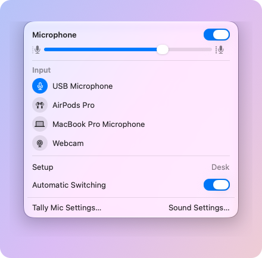

# Tally Mic

**The Sound menu, for your microphone.** 
Pick a mic in one click, mute it from anywhere, and let your Mac switch to the right one by itself.

Free and open source · macOS 27 or later · Apple silicon · <a href="https://github.com/MarcusWF-guy/Tally-Mic/releases">All releases</a>

 

<picture>
  <source media="(prefers-color-scheme: dark)" srcset=".github/readme/menu-dark.png">
  
</picture>

## What it does

macOS has a menu bar menu for picking your speakers, but choosing a microphone means a trip to System Settings. Tally Mic adds the missing menu, and looks like it's always been there.

- **Pick a mic in one click.** The same layout as the Sound menu: input volume, your microphones, and a shortcut to Sound Settings.
- **Hide the clutter.** Zoom and Teams install virtual audio devices you'll never pick. Hide them, or give your mics shorter names.
- **The right mic, automatically.** Put your mics in order of preference, and Tally Mic uses the best one that's connected, so macOS stops jumping to whatever you plugged in last. Have a different order at your desk and on the go: Tally Mic notices when you plug in your monitor. A headset's mic is only used while you're listening through that headset.
- **Mute from anywhere.** One switch, or a keyboard shortcut, mutes whichever mic is in use, and keeps you muted when the mic changes.
- **Keyboard shortcuts.** Optional shortcuts to mute, switch to a particular mic, turn automatic switching on or off, or open the menu, from any app.
- **Monitor volume.** When your sound plays through an external monitor's speakers, the volume keys change the monitor's volume, with the same volume bubble as your Mac's. Optional.

## Install

1. **[Download Tally Mic](https://github.com/MarcusWF-guy/Tally-Mic/releases/latest/download/Tally-Mic.zip)**, open the zip, and drag **Tally Mic** into your **Applications** folder.
2. Open it. macOS warns that it can't check Tally Mic for malware, because Tally Mic isn't signed through Apple's paid developer program. Click **Done**.
3. Open **System Settings > Privacy & Security**, scroll down, and click **Open Anyway** next to the message about Tally Mic. Confirm when macOS asks. You only do this once.

A mic icon appears in your menu bar, and Tally Mic starts by itself when you log in. You need a Mac with Apple silicon (M1 or later) on macOS 27 or later.

## Getting started

**Click** the mic icon to pick a microphone or change its volume. **Right-click** it for Settings, where you can:

- **Devices:** hide microphones or rename them.
- **Setups:** put your mics in order, for your desk (when a particular monitor is connected) and for everywhere else. Then turn on Automatic Switching, in the menu or in General.
- **Shortcuts:** set keyboard shortcuts.
- **General:** turn on monitor volume. macOS asks for Accessibility permission, which lets Tally Mic use the volume keys.

**Using Zoom, Teams or Meet?** Set the microphone in each to the option that follows the system ("Same as System" in Zoom). Otherwise those apps ignore what you pick in Tally Mic.

<b>Updating</b>

 

Settings > General shows which version you have, with a button to the releases. To update, quit Tally Mic (right-click its icon > Quit Tally Mic), download the new version, and replace the app in Applications. Your settings and permissions stay.

<b>Uninstalling</b>

 

Quit Tally Mic and drag it from Applications to the Trash. To remove its settings and log too, delete `~/Library/Application Support/Tally Mic` and `~/Library/Logs/Tally Mic`. If you turned on monitor volume, also remove Tally Mic from System Settings > Privacy & Security > Accessibility.

## Privacy

Tally Mic never records or listens to anything, so it never asks for microphone access: it only tells macOS which mic to use. It doesn't go online and collects nothing. Its settings and log stay on your Mac.

## Feedback

Found a bug, or have an idea? **[Open an issue](https://github.com/MarcusWF-guy/Tally-Mic/issues/new/choose).** For a bug, the form asks for Tally Mic's diagnostics (Settings > General > Copy Diagnostics), which help a lot.

## License

[MIT](LICENSE). Want to build it yourself or work on it? See [DEVELOPMENT.md](DEVELOPMENT.md).
